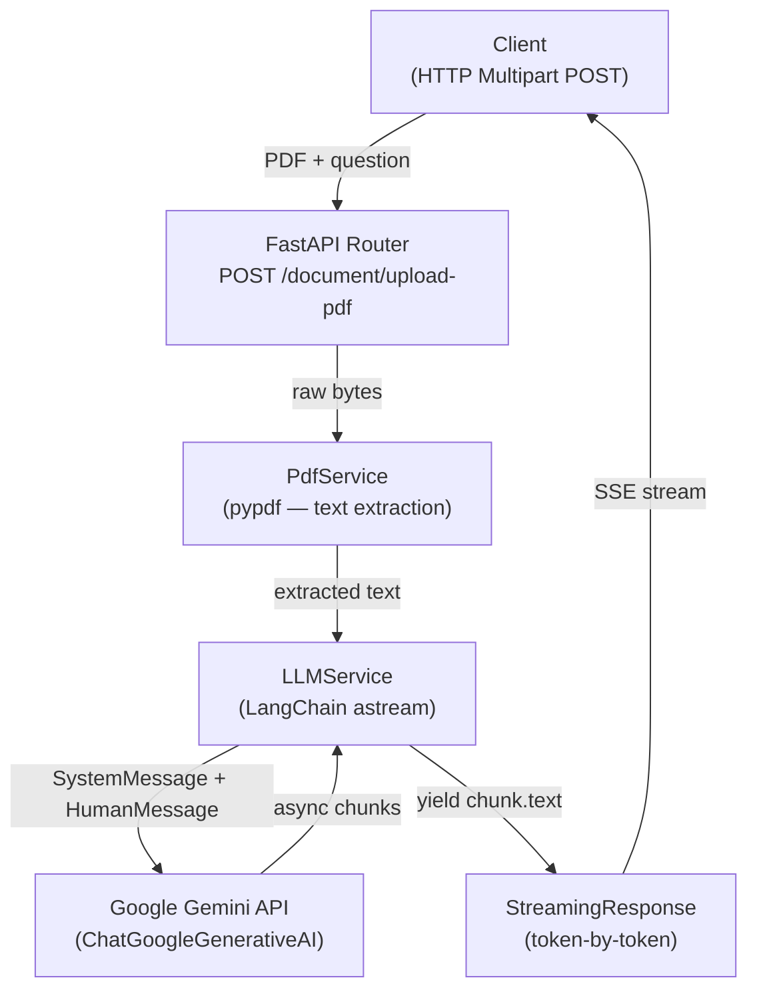

# Document QA API

A **FastAPI**-based backend service that lets users upload a PDF document and ask natural language questions about it. Answers are streamed back in real-time using Google's Generative AI (Gemini) via LangChain.

---

## Table of Contents

- [Overview](#overview)
- [Architecture](#architecture)
- [Project Structure](#project-structure)
- [API Reference](#api-reference)
- [Configuration](#configuration)
- [Running Locally](#running-locally)
- [Running with Docker](#running-with-docker)
- [Development](#development)
- [Known Issues](#known-issues)

---

## Overview

| Property        | Value                                          |
|-----------------|------------------------------------------------|
| Framework       | FastAPI (Python 3.13+)                         |
| LLM Provider    | Google Generative AI (Gemini) via LangChain    |
| PDF Parsing     | pypdf                                          |
| Response Style  | Server-Sent Streaming (`StreamingResponse`)    |
| Max File Size   | 5 MB                                           |
| Chunk Read Size | 1 MB                                           |

The service receives a **PDF file** and a **question** in a single multipart request, extracts the full text from the PDF, injects it into a system prompt, and streams the LLM's answer token-by-token back to the client.

---

## Architecture



### Component Responsibilities

| Component | Location | Responsibility |
|-----------|----------|----------------|
| `main.py` | `app/main.py` | FastAPI app factory, lifespan event (sets `GOOGLE_API_KEY` env var), root health-check endpoint |
| `routers.py` | `app/api/routers.py` | Aggregates all versioned routers into a single `APIRouter` |
| `document.py` | `app/api/v1/document.py` | `POST /document/upload-pdf` endpoint — chunked file read, size guard, orchestration |
| `dependencies.py` | `app/api/dependencies.py` | FastAPI `Depends` providers: `ChatGoogleGenerativeAI`, `LLMService`, `PdfService` |
| `LLMService` | `app/services/llm_service.py` | Wraps LangChain `astream` to yield text chunks from the Gemini model |
| `PdfService` | `app/services/pdf_service.py` | Reads raw PDF bytes with `pypdf`, concatenates all page text |
| `QAModel` | `app/schema/qa_model.py` | Pydantic request model — `question` (5–100 chars) + `file` (`UploadFile`) |
| `config.py` | `app/core/config.py` | `pydantic-settings` model loading `GOOGLE_API_KEY` and `GOOGLE_MODEL` from `.env` |
| `system_prompt.txt` | `app/core/system_prompt.txt` | Strict grounding prompt; injects `{pdf_content}` at runtime |

### Request Flow (Step-by-Step)

1. Client sends `multipart/form-data` with `file` (PDF) and `question` fields.
2. The endpoint reads the file in **1 MB chunks** and enforces the **5 MB size limit**.
3. `PdfService.read()` converts bytes → `BytesIO` → `PdfReader`, concatenating all page text.
4. `LLMService.chat()` builds a `[SystemMessage, HumanMessage]` list and calls `llm.astream(...)`.
5. Each streamed token (`chunk.text`) is `yield`-ed directly through `StreamingResponse`.

---

## Project Structure

```
document_qa_api/
├── app/
│   ├── main.py                  # FastAPI app entry point
│   ├── api/
│   │   ├── dependencies.py      # Dependency injection providers
│   │   ├── routers.py           # Router aggregation
│   │   └── v1/
│   │       └── document.py      # /document/upload-pdf endpoint
│   ├── core/
│   │   ├── config.py            # Settings (pydantic-settings)
│   │   └── system_prompt.txt    # LLM system prompt template
│   ├── schema/
│   │   └── qa_model.py          # QAModel Pydantic request schema
│   └── services/
│       ├── llm_service.py       # LangChain streaming wrapper
│       └── pdf_service.py       # pypdf text extraction
├── Dockerfile
├── pyproject.toml
├── .env                         # (not committed) API keys
└── README.md
```

---

## API Reference

### `GET /`
Health-check endpoint.

**Response:**
```json
{ "message": "Hello World" }
```

---

### `POST /document/upload-pdf`

Upload a PDF and receive a streamed answer to your question.

**Request:** `multipart/form-data`

| Field      | Type       | Constraints               | Description                        |
|------------|------------|---------------------------|------------------------------------|
| `question` | `string`   | min 5, max 100 characters | Question to answer from the PDF    |
| `file`     | `UploadFile` | PDF, max 5 MB           | The PDF document to query          |

**Response:** `StreamingResponse` — LLM answer streamed token-by-token as plain text.

**Error Responses:**

| Status | Condition                          |
|--------|------------------------------------|
| `400`  | PDF file is empty or has no text   |
| `413`  | File exceeds 5 MB limit            |
| `422`  | Validation error (bad question)    |

---

## Configuration

Create a `.env` file in the project root:

```env
GOOGLE_API_KEY=your_google_api_key_here
GOOGLE_MODEL=gemini-2.0-flash
```

| Variable         | Required | Description                         |
|------------------|----------|-------------------------------------|
| `GOOGLE_API_KEY` | ✅       | Google AI API key for Gemini        |
| `GOOGLE_MODEL`   | ✅       | Gemini model name (e.g. `gemini-2.0-flash`) |

---

## Running Locally

```bash
# 1. Create and activate a virtual environment
python -m venv venv
venv\Scripts\activate        # Windows
# source venv/bin/activate   # macOS/Linux

# 2. Install dependencies
pip install .

# 3. Add your .env file (see Configuration above)

# 4. Start the server
fastapi dev app/main.py
```

The API will be available at `http://localhost:8000`.  
Interactive docs: `http://localhost:8000/docs`

---

## Development

### Tech Stack

| Tool | Purpose |
|------|---------|
| [FastAPI](https://fastapi.tiangolo.com/) | Web framework |
| [LangChain](https://python.langchain.com/) | LLM abstraction & streaming |
| [langchain-google-genai](https://python.langchain.com/docs/integrations/chat/google_generative_ai/) | Gemini integration |
| [pypdf](https://pypdf.readthedocs.io/) | PDF text extraction |
| [pydantic-settings](https://docs.pydantic.dev/latest/concepts/pydantic_settings/) | Config management |
| [pytest](https://pytest.org/) + [pytest-asyncio](https://pytest-asyncio.readthedocs.io/) | Async testing |
| [ruff](https://docs.astral.sh/ruff/) | Linting & formatting |
| [mypy](https://mypy.readthedocs.io/) | Static type checking |